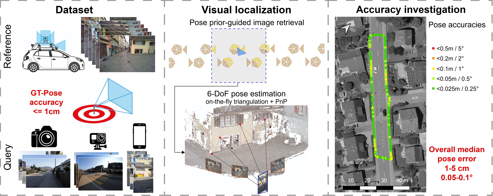

  

# [FHNW Muttenz Visual Localization Dataset](https://fhnw-muttenz-vl-dataset.github.io/)

A large-scale, real-world high-resolution street-level visual localization dataset with 6-DoF ground-truth poses accurate to 6–9 mm in position and below 0.1° in orientation — built to test whether visual localization can match survey-grade GNSS positioning (< 5 cm accuracy under favorable conditions). **[Explore the full documentation](https://fhnw-muttenz-vl-dataset.github.io/)**.

## At a glance

- **Coverage:** Contiguous street network, ~10 km
- **Reference mapping campaigns:** 2 (2023, 2025; ~1.5 years apart)
- **Query sequences:** 20 (5 scenes each captured with 4 cameras)
- **Query images:** 5399
- **Ground-truth pose accuracy (co-registration):** 6–9 mm in position, < 0.1° in orientation
- **Georeferencing accuracy:** 2.5 cm

## Repository contents

- `docs/` — source of the [documentation site](https://fhnw-muttenz-vl-dataset.github.io/) (Jekyll)
- `scripts/` — utility scripts for working with the dataset files, see [scripts/README.md](scripts/README.md)

## License

This dataset is licensed under [CC BY-NC 4.0](https://creativecommons.org/licenses/by-nc/4.0/deed.en). See [LICENSE.md](LICENSE.md) for details.

## Questions

Please [open an issue](https://github.com/FHNW-Muttenz-vl-dataset/FHNW-Muttenz-vl-dataset.github.io/issues) on this repository.
