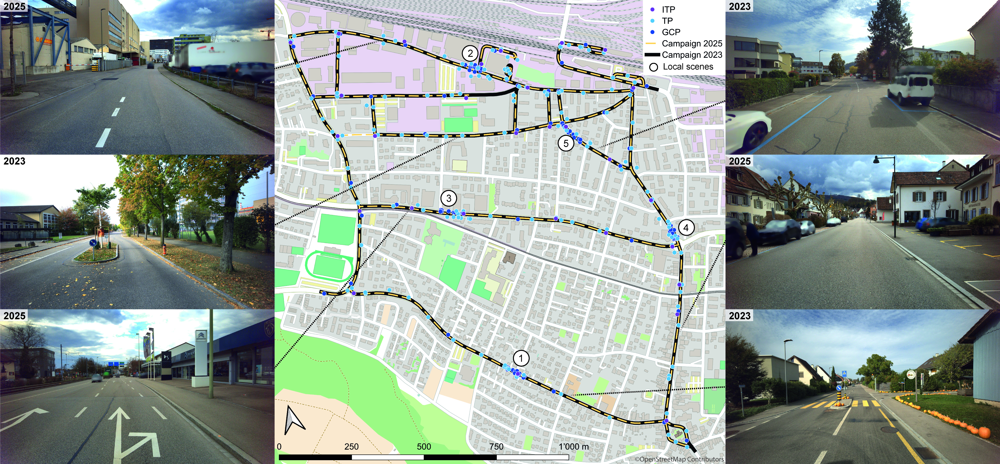

# Dataset

This dataset currently consists of two reference mapping campaigns covering the entire study area (see below) and query images acquired with four different camera systems in five small-scale scenes along the mapping perimeter. **[Reference data](dataset/reference-data.md)** and **[query sequences](dataset/query-sequences.md)** are described in detail on separate pages.

## Study area

The study area (Figure 1) encompasses various districts of Muttenz, a suburban municipality near Basel, Switzerland. The areas covered include parts of a historic town center dating back to the 17th century, commercial areas, residential areas with detached houses, multi-story apartment buildings, diverse vegetation, and a mixed industrial area with production facilities and brownfield sites with parked vehicles and trucks. The road network, with a length of approximately 10 km, exhibits substantial heterogeneity, encompassing multi-lane roads, intersections with tram lines, wide pedestrian sidewalks, and ordinary two- and single-lane roads in residential areas.




***Figure 1:*** *The study area in which our dataset was collected. The map shows the street network covered by two mobile mapping campaigns, the GCPs, TPs, and ITPs used for co-registration and georeferencing, as well as the locations of the local scenes (circled numbers). In addition, a number of representative images provide an impression of the conditions on site. Background map: © OpenStreetMap contributors*


## Timeline of data acquisition

- **2023** - 09 October 2023 - first mobile-mapping campaign
- **2025** - 03 / 04 February 2025 - acquisition of query images
- **2025** - 11 March 2025 - second mobile-mapping campaign

## Ground-truth generation

**Ground-truth poses exhibit relative accuracies (co-registration accuracy) of < 1 cm**. The procedure for ground-truth pose generation differs for each dataset component — see [Reference Data](dataset/reference-data.md) and [Query Sequences](dataset/query-sequences.md) for details on the respective co-registration and georeferencing procedures and achieved accuracies.

## Data format

### Naming conventions
We use the following naming conventions to create unique image names that avoid naming collisions.

For reference data we use the combination of the capture system, capture timestamp and camera index as image name: `{capture_system_acronym}_{timestamp}_{camera_index}.png`, e.g. `p_2023-10-09_11-44-44-267799_4.png`. The trailing camera index matches the `camera_name` / `T_cam{i}_cam0` index in `camera_system.json` (0–4 for the panorama rig, 0–1 for the stereo rigs, 0 only for the mono rig).

Query image names are created by combining the scene index, sensor name, sequence index and capture date followed by a frame counter: `{scene_index}_{sensor_name}_{sequence_index}_{yyyy-mm-dd}_{frame_counter:05d}.jpg`, e.g. `1_canon-eosr-24mm_0_2025-02-04_00000.jpg`.

### Folder structure

```
Reference_campaigns/
├── 2023_reference_campaign/
│   ├── panorama_camera/
│   │   ├── camera_system.json
│   │   ├── poses.json
│   │   └── images/
│   ├── stereo_front/
│   │   ├── camera_system.json
│   │   ├── poses.json
│   │   └── images/
│   ├── stereo_back_left/     # same layout as stereo_front
│   └── stereo_back_right/    # same layout as stereo_front
└── 2025_reference_campaign/
    ├── mono_front/
    │   ├── camera_system.json
    │   ├── poses.json
    │   └── images/
    └── panorama_camera/
        ├── camera_system.json
        ├── poses.json
        └── images/
```

```
Query_sequences/
├── scene_1/
│   ├── canon_eosr_24mm/
│   │   └── 0
│   │       ├── camera_info.json
│   │       ├── poses.json
│   │       └── images/
│   │           └── 1_canon-eosr-24mm_0_2025-02-04_00000.jpg
│   ├── canon_eosr_35mm/            # same internal layout
│   ├── gopro_hero7/                # same internal layout
│   └── iphone_14pro/               # same internal layout
└── scene_2/ … scene_5/             # identical layout
```

#### Metadata schema

`camera_system.json`

```
{
    "camera_system_description": "stereo_back_right",
    "camera_system_acronym": "sbr",
    "cameras": [
        {
            "camera_name": "camera_0",
            "width": 4864,
            "height": 3232,
            "focal_length_px": 2567.56757,
            "T_cam0_cam0": [
                1.0, 0.0, 0.0, 0.0, 0.0, 1.0, 0.0, 0.0, 0.0, 0.0, 1.0, 0.0, 0.0, 0.0, 0.0, 1.0
            ]
        },
        {
            "camera_name": "camera_1",
            "width": 4864,
            "height": 3232,
            "focal_length_px": 2567.56757,
            "T_cam1_cam0": [
                1.0, 0.0, 0.0, 0.711, 0.0, 1.0, 0.0, 0.0, 0.0, 0.0, 1.0, 0.0, 0.0, 0.0, 0.0, 1.0
            ]
        }
    ]
}
```

`camera_info.json`
```
{
    "camera_make": "Canon",
    "camera_model_name": "Canon EOS R",
    "lens_model": "RF24mm F1.8 MACRO IS STM",
    "projection_type": "perspective",
    "width": 6720,
    "height": 4480,
    "focal_length_px": 4600.7663
}
```

`poses.json`
```
{
    "1_canon-eosr-35mm_0_2025-02-04_00000.jpg": [
        -0.18598945809592418,
        0.6696346370931495,
        0.7190252946053501,
        4276721.241549468,
        0.980576290729368,
        0.08012077171541336,
        0.17902737220648932,
        573610.6339722123,
        0.06227406793054958,
        0.7383563602657274,
        -0.671529467498284,
        4681650.125424144,
        0.0,
        0.0,
        0.0,
        1.0
    ]
}
```
*(one entry per image; only one shown here for brevity)*

### Image poses and relative orientations

We provide an image pose for each image in `poses.json`. The relative orientations of the camera systems used for reference data acquisition are specified in the `camera_system.json` files.

#### Conventions

- **Notation:** $$T_a^b$$ denotes the transform from frame *a* to frame *b*, i.e. $$p_b = T_a^b\, p_a$$.
- **Homogeneous coordinates:** $$\tilde{p}$$ denotes a point in homogeneous coordinates, $$\tilde{p} = [x, y, z, 1]^T$$.
- **Matrix format:** all poses and relative orientations are given as row-major flattened 4×4 arrays. E.g. for a matrix with rotation $$r_{ij}$$ and translation $$(t_x, t_y, t_z)$$, the flat array is: [r11, r12, r13, tx, r21, r22, r23, ty, r31, r32, r33, tz, 0, 0, 0, 1].

#### Image poses

Image poses describe the transformation from **camera to world** coordinates.

- **World coordinate system:** WGS84 Earth-Centered, Earth-Fixed (ECEF) coordinates, in metres.
- **Camera coordinate system:** follows the **photogrammetric convention** — x-axis points right, y-axis points upward, z-axis points backward (toward the viewer).

$$
\tilde{p}_{world} = T_{cam}^{world}\, \tilde{p}_{cam}
$$

#### Relative orientations

Relative orientations describe the transformation from a given camera sensor to the reference sensor, **cam0** (i.e. camX → cam0). These also use the photogrammetric convention (x right, y up, z backward).

$$
\tilde{p}_{cam_{0}} = T_{cam_{x}}^{cam_{0}}\, \tilde{p}_{cam_{x}}
$$

#### Changing camera coordinate convention

If you need poses and relative orientations expressed in camera coordinates following **computer vision convention** instead (x right, y downward, z forward), use the fixed conversion matrix below. Because it only flips the y- and z-axes, this matrix is its own inverse, so the same matrix converts in both directions:

$$
T_{cam_{ph}}^{cam_{cv}} = T_{cam_{cv}}^{cam_{ph}} = 
\begin{bmatrix}
1 & 0 & 0 & 0 \\
0 & -1 & 0 & 0 \\
0 & 0 & -1 & 0 \\
0 & 0 & 0 & 1
\end{bmatrix}
$$

**Image poses:** the world frame is unaffected by camera convention, so only the camera-side (input) needs remapping:

$$
T_{cam_{cv}}^{world} = T_{cam_{ph}}^{world}\, T_{cam_{cv}}^{cam_{ph}}
$$

**Relative orientations:** both endpoints (camX and cam0) are camera frames, so both sides are remapped:

$$
T_{cam_{x_{cv}}}^{cam_{0_{cv}}} = T_{cam_{ph}}^{cam_{cv}}\, T_{cam_{x_{ph}}}^{cam_{0_{ph}}}\, T_{cam_{cv}}^{cam_{ph}}
$$

A reference implementation of both conversions is available in [`scripts/pose_conversion.py`](https://github.com/FHNW-Muttenz-vl-dataset/FHNW-Muttenz-vl-dataset.github.io/blob/main/scripts/pose_conversion.py).