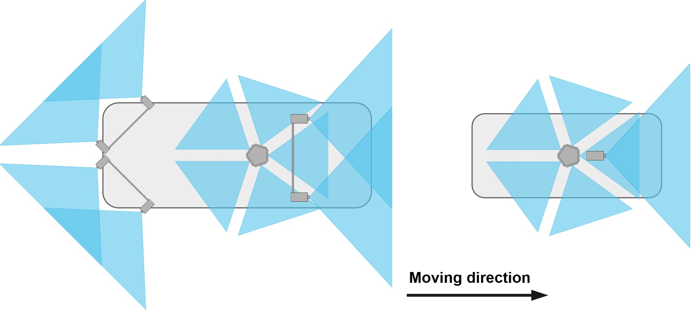

# Reference data

As reference data, street-level imagery was acquired using vision-based mobile mapping systems (MMS) twice for the entire study area. The first campaign was conducted in autumn (October) 2023. The weather conditions during the first campaign were predominantly sunny, resulting in shadow patterns, and the trees showed slightly tinted foliage. The second campaign was conducted in early spring (March) 2025, under overcast skies, resulting in diffuse light, with trees free of foliage. During both campaigns, extensive construction work was in progress, including the complete redesign of entire road sections.

<h4 align="center">2023 reference campaign</h4>

<h4 align="center">2025 reference campaign</h4>

## Mapping system specifications

The MMS employed for reference mapping varied regarding their camera setup. In the 2023 campaign, the camera setup consisted of three high-resolution stereo systems facing the front, back right, and back left, combined with a medium-resolution multi-head panorama camera, Ladybug5+. In 2025, the MMS was equipped with a high-resolution monocular camera facing the front and a high-resolution multi-head panorama camera, Ladybug6.
The specification of each camera system as well as the footprints are provided in Table 1 and Figure 1.

<table class="mm-table">
  <thead>
    <tr>
      <th class="col-left" rowspan="2">Camera system</th>
      <th colspan="2" class="fov-h">FoV [°]</th>
      <th rowspan="2">Resolution</th>
    </tr>
    <tr>
      <th class="fov-h">h</th>
      <th>v</th>
    </tr>
  </thead>
  <tbody>
    <tr><td class="section-row" colspan="4">Mobile mapping campaign 2023</td></tr>
    <tr>
      <td class="col-left">Stereo front</td>
      <td class="fov-h">96.0</td>
      <td>64.1</td>
      <td>5472 &times; 3084</td>
    </tr>
    <tr>
      <td class="col-left">Stereo back left</td>
      <td class="fov-h">86.9</td>
      <td>64.4</td>
      <td>4864 &times; 3232</td>
    </tr>
    <tr>
      <td class="col-left">Stereo back right</td>
      <td class="fov-h">86.9</td>
      <td>64.4</td>
      <td>4864 &times; 3232</td>
    </tr>
    <tr>
      <td class="col-left">Ladybug 5+ (per head)</td>
      <td class="fov-h">73.0</td>
      <td>86.0</td>
      <td>1536 &times; 1936</td>
    </tr>
    <tr><td class="section-row" colspan="4">Mobile mapping campaign 2025</td></tr>
    <tr>
      <td class="col-left">Mono front</td>
      <td class="fov-h">75.1</td>
      <td>46.9</td>
      <td>5472 &times; 3084</td>
    </tr>
    <tr>
      <td class="col-left">Ladybug 6 (per head)</td>
      <td class="fov-h">73.0</td>
      <td>86.0</td>
      <td>2918 &times; 3677</td>
    </tr>
  </tbody>
</table>
***Table 1:*** *Camera systems used in mobile mapping campaigns 2023 and 2025.*

***Figure 1:*** *Configuration of the mobile mapping systems used for data acquisition during: (left) campaign 2023; (right) campaign 2025. The mapping platforms are visualized to scale.*

During the reference mapping campaigns, all cameras were triggered synchronously at approximately 4 m intervals. Wide roads were traversed in both directions, while narrow roads were traversed only once. Construction activities slightly changed the road network coverage between campaigns. The number of acquired images per campaign and camera system is reported in the Table 2.

<table class="mm-table">
  <thead>
    <tr>
      <th class="col-left">Camera system</th>
      <th># Images</th>
    </tr>
  </thead>
  <tbody>
    <tr><td class="section-row" colspan="2">Campaign 2023</td></tr>
    <tr>
      <td class="col-left">Stereo front / back left / right each</td>
      <td>8054</td>
    </tr>
    <tr>
      <td class="col-left">Panorama camera</td>
      <td>20135</td>
    </tr>
    <tr class="total-row">
      <td class="col-left">Total</td>
      <td>44297</td>
    </tr>
    <tr><td class="section-row" colspan="2">Campaign 2025</td></tr>
    <tr>
      <td class="col-left">Mono front</td>
      <td>4170</td>
    </tr>
    <tr>
      <td class="col-left">Panorama camera</td>
      <td>20850</td>
    </tr>
    <tr class="total-row">
      <td class="col-left">Total</td>
      <td>25020</td>
    </tr>
  </tbody>
</table>

***Table 2:*** *Number of reference images acquired for our dataset grouped by campaign and camera system. The panorama counts are the total over the five camera heads (4,027 and 4,170 images per head in 2023 and 2025).*

## Calibration

All camera systems are pre-calibrated, yielding distortion-free images; stereo camera images are additionally rectified. Panoramic images are remapped from cube maps into their original camera heads to avoid stitching errors caused by the differing projection centers of the panorama heads, yielding five non-overlapping images (one per camera head). Each image has a horizontal FoV of approximately 72°.

## Ground-truth generation

Initial image poses are computed via integrated georeferencing, using 32 ground control points (GCPs) determined by RTK-GNSS and evenly distributed across the mapping perimeter, giving a default georeferencing accuracy in the sub-decimeter range.

A two-step strategy is applied to refine the image poses to millimeter-level relative accuracy:
  1. **Per-campaign image-based georeferencing** — bundle adjustment refinement in Agisoft Metashape, with stereo and panorama systems modeled as multi-camera rigs using relative orientation constraints; integrated-georeferencing poses are used to efficiently select image pairs for matching
  2. **Cross-campaign co-registration** — a global bundle adjustment incorporating 69 GCPs (RTK-GNSS; of these, 66 were measurable in the 2023 imagery and 46 in the 2025 imagery, 43 of them in both) and 180 manually measured tie points (TPs, each identified across ~10 images per campaign), together with the initial 6-DoF image poses (GCP positional standard deviation 5 cm; image pose translation standard deviation 10 cm, rotation standard deviation 1°)

**Co-registration accuracy** is validated using 29 independent tie points (ITPs), excluded from the bundle adjustment, by triangulating GCP/TP/ITP 3D coordinates independently per campaign and comparing the 2023 and 2025 campaigns (Table 3). The results confirm millimeter-level co-registration accuracy (all below 1 cm).

<table class="mm-table">
  <thead>
    <tr>
      <th class="col-left">Point type</th>
      <th># Points</th>
      <th>X RMSE [m]</th>
      <th>Y RMSE [m]</th>
      <th>Z RMSE [m]</th>
      <th>3D RMSE [m]</th>
    </tr>
  </thead>
  <tbody>
    <tr><td class="col-left">GCPs</td><td>43</td><td>0.001</td><td>0.002</td><td>0.001</td><td>0.002</td></tr>
    <tr><td class="col-left">TPs</td><td>180</td><td>0.004</td><td>0.004</td><td>0.002</td><td>0.006</td></tr>
    <tr><td class="col-left">ITPs</td><td>29</td><td>0.003</td><td>0.003</td><td>0.002</td><td>0.005</td></tr>
  </tbody>
</table>
***Table 3:*** *Co-registration accuracy between the 2023 and 2025 reference campaigns.*

**Absolute georeferencing accuracy**, assessed separately per campaign from GCP residuals, is a few centimeters (Table 4). These GCPs were also used in the bundle adjustment, so this is an internal measure of accuracy rather than an independent validation.

<table class="mm-table">
  <thead>
    <tr>
      <th class="col-left">Campaign</th>
      <th># Points</th>
      <th>3D RMSE [m]</th>
    </tr>
  </thead>
  <tbody>
    <tr><td class="col-left">2023</td><td>66</td><td>0.025</td></tr>
    <tr><td class="col-left">2025</td><td>46</td><td>0.025</td></tr>
  </tbody>
</table>
***Table 4:*** *Absolute georeferencing accuracy per reference campaign.*
