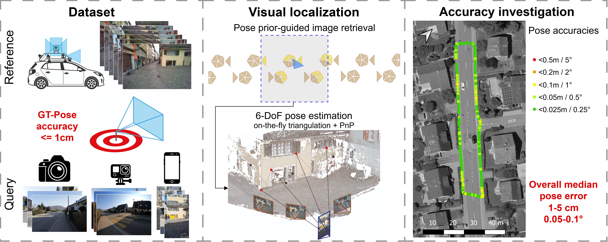

# FHNW Muttenz visual localization dataset

**A large-scale, real-world high-resolution street-level visual localization dataset with 6-DoF ground-truth poses accurate to 6–9 mm in position and below 0.1° in orientation — built to test whether visual localization can match survey-grade GNSS positioning (< 5 cm accuracy under favorable conditions).**

[Explore the Dataset](dataset.md){: .btn .btn-primary } [Download](download.md){: .btn .btn-primary } [Read the Paper](publications.md){: .btn .btn-primary } [What's next?](roadmap.md){: .btn .btn-primary }

## At a glance

| Coverage                     | Contiguous street network, ~10 km             |
| Reference mapping campaigns  | 2 (2023, 2025; ~1.5 years apart)               |
| Query sequences       | 20 (5 scenes each captured with 4 cameras)                                              |
| Query images          | 5399                                         |
| Ground-truth pose accuracy (co-registration) | 6–9 mm in position, < 0.1° in orientation |
| Georeferencing accuracy      | 2.5 cm                                        |
{: .plain-table }

---

For questions [open an issue on GitHub](https://github.com/FHNW-Muttenz-vl-dataset/FHNW-Muttenz-vl-dataset.github.io).
